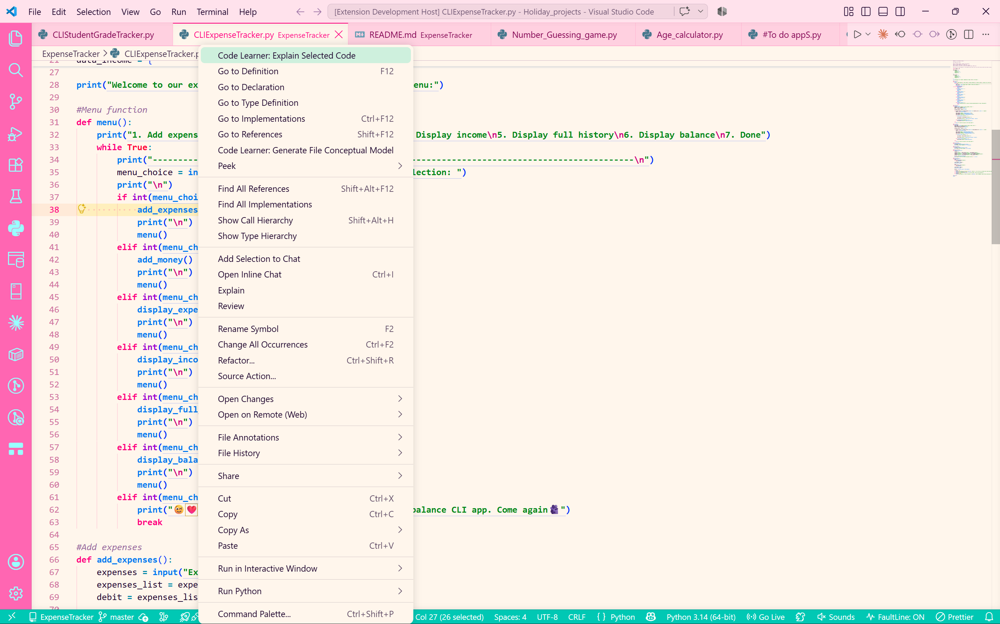
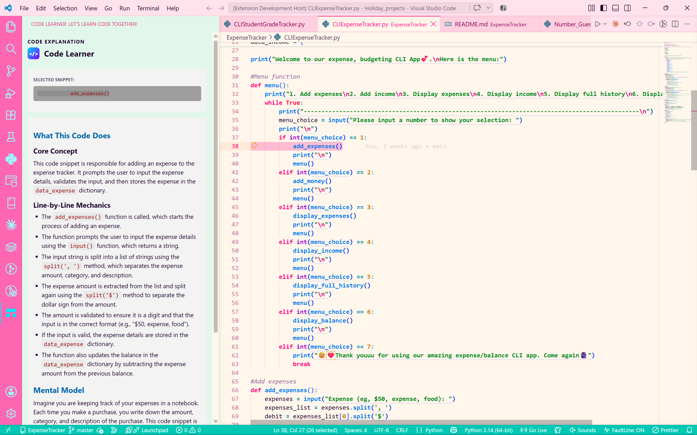
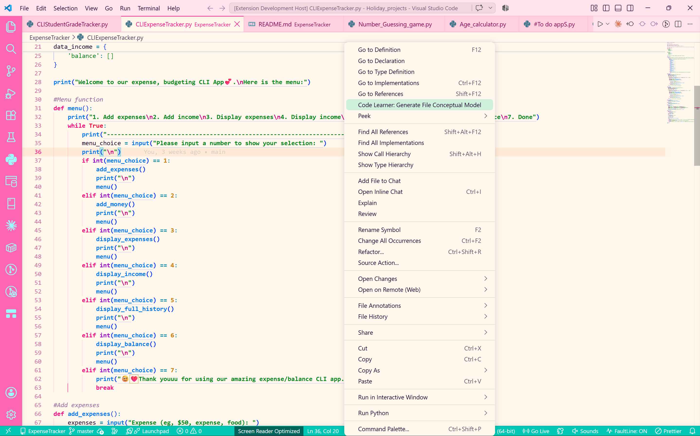
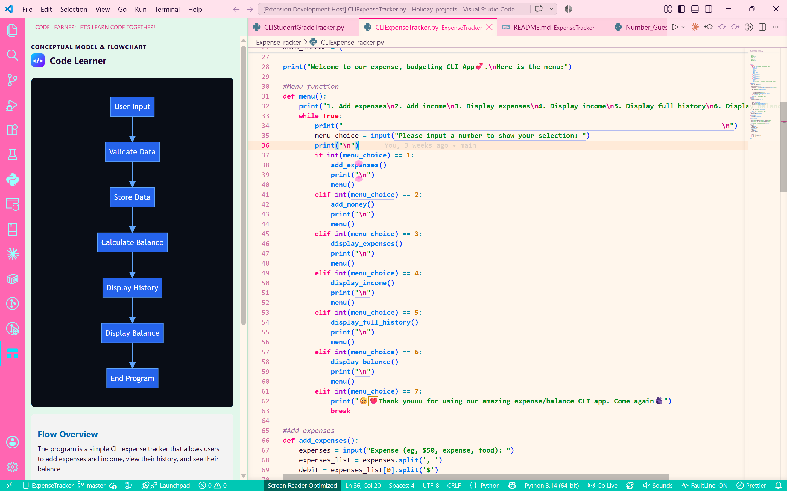

# Code Learner

**Code Learner** is an absolute beginner’s programming assistant designed to bridge the gap between complex code syntax and plain, intuitive understanding. 

Instead of toggling between web browsers or copying and pasting code across windows, **Code Learner** translates highlighted code snippets into plain English and generates visual conceptual flowcharts directly inside a dedicated VS Code sidebar.

---

## See It In Action

### 1. Code Explanation Mode
Highlight any code snippet, right-click, and select **Code Learner: Explain Selected Code** to view a full context-aware breakdown in the sidebar.

| 1. Select Code & Right-Click | 2. Read Plain-English Explanation |
| :---: | :---: |
|  |  |

---

### 2. Conceptual Model & Flowchart Mode
Open any file in your editor to automatically scan its structure and render a vertical flowchart with high-level logic summaries.

| 1. Active Editor Focus | 2. Visual Conceptual Flowchart |
| :---: | :---: |
|  |  |

---

## Features

* **Unified Activity Bar Sidebar:** Runs seamlessly in VS Code's sidebar—no extra editor tabs or modal popups blocking your workspace.
* **Full-File Context Awareness:** Explains highlighted snippets accurately by analyzing local variables, custom classes, and imported module references across your file.
* **Auto-Scanning Conceptual Flowcharts:** Automatically generates vertical, high-contrast visual flowcharts summarizing inputs, logic processing, and outputs when switching active files.
* **Beginner-Focused & Jargon-Free:** Cuts out complex jargon and breaks down logic with clear mental models and real-world analogies.
* **Clean & Modern UI:** Dark-mode optimized, theme-aware, and stripped of clutter for an intuitive learning workflow.

---

## How to Use

### Explaining a Specific Code Snippet
1. Open any source file and highlight a snippet or function.
2. **Right-click** and select **Code Learner: Explain Selected Code** (or press `Ctrl+Shift+P` / `Cmd+Shift+P` and search `Code Learner: Explain Selected Code`).

3. View the detailed line-by-line mechanics, core concepts, and mental models inside the sidebar.

---

### Generating a Conceptual Model & Flowchart
1. Open any source code file in your editor.

2. Open the **Code Learner** tab from the Activity Bar.
3. Code Learner automatically scans the file and renders a visual flowchart along with an operational summary.

---

## Extension Settings

This extension includes the following settings:

* `codeLearner.apiKey`: (Optional) Your API key for Groq (`gsk_...`) or Hugging Face (`hf_...`) inference proxy integration.

---

## Requirements

* VS Code `v1.125.0` or higher.
* Active internet connection for lightweight proxy inference.

---

## License

Distributed under the MIT License.