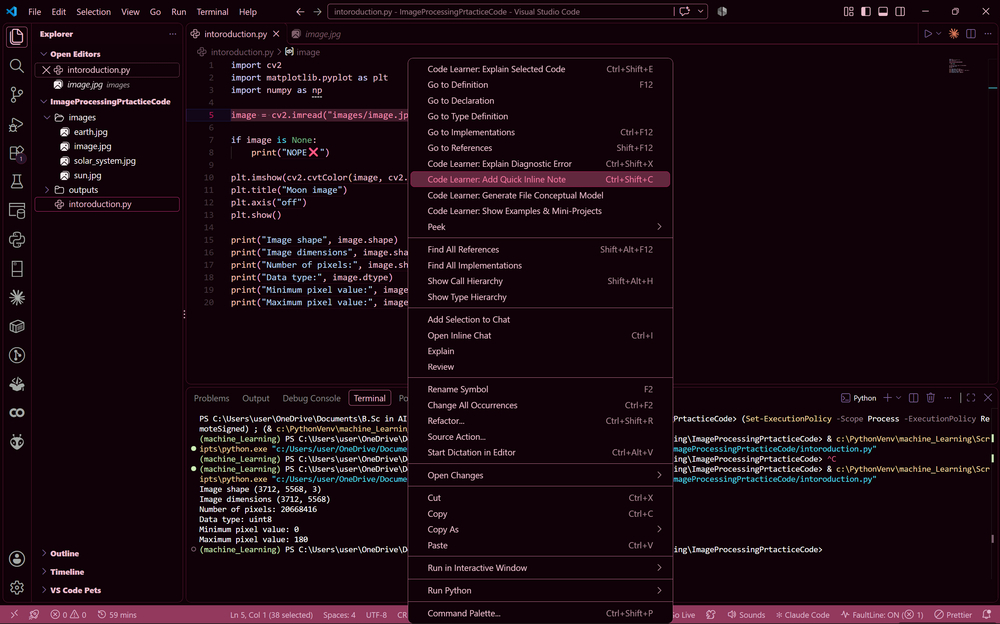
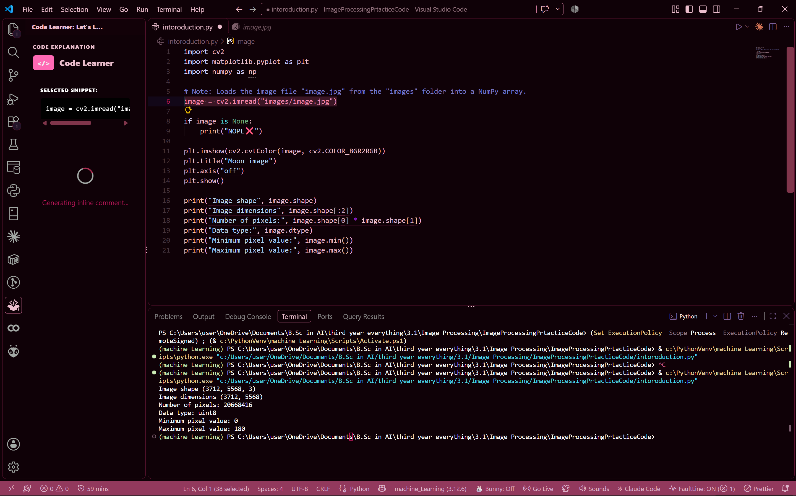
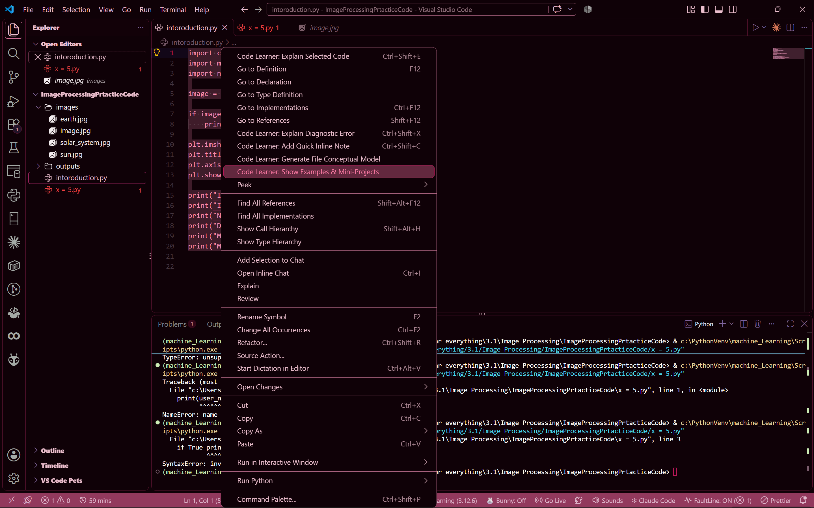
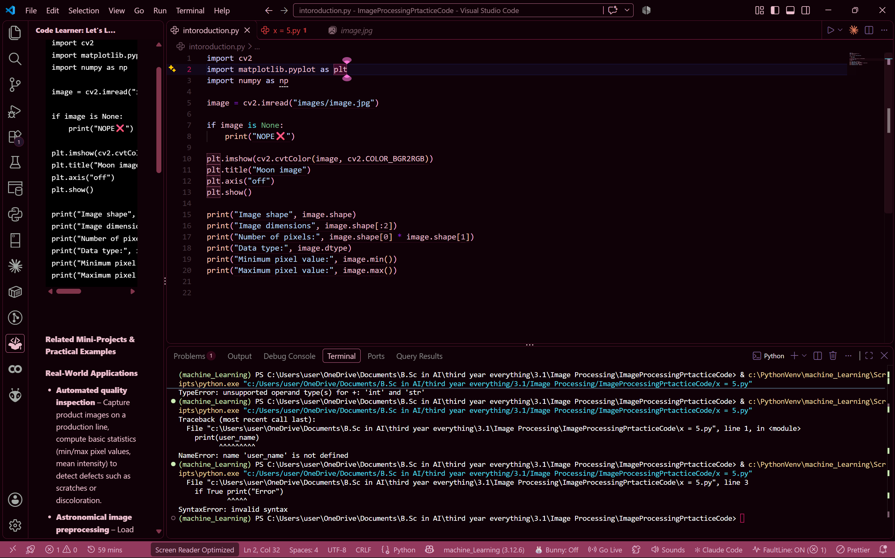

# Code Learner

An AI-powered programming assistant for absolute beginners, built as a Visual Studio Code extension.

Code Learner helps bridge the gap between complex code syntax and intuitive understanding. It explains highlighted code in plain English, clarifies programming errors, generates inline comments, suggests practical examples, and visualises program logic through conceptual flowcharts.

**The idea is simple: highlight code, get an explanation, and learn as you go.**

Instead of switching between browser tabs or copying code into external tools, you can explore and understand code directly inside your editor.

## See It in Action

### 1. Code Explanation

Highlight any code snippet, right-click, and select `Code Learner: Explain Selected Code` to receive a context-aware explanation in plain English.

|          Select Code & Right-Click          |                Read the Explanation                |
| :-----------------------------------------: | :------------------------------------------------: |
|  |  |

### 2. Conceptual Models & Flowcharts

Open a source file and access the Code Learner sidebar to generate a visual representation of the file's structure and logic.

|               Active Editor              |                  Generated Flowchart                 |
| :--------------------------------------: | :--------------------------------------------------: |
|  |  |

### 3. Inline Comments

Generate explanatory comments for selected code to make its purpose and behaviour easier to understand.

|             Generate an Inline Note            |              Understand Your Code             |
| :--------------------------------------------: | :-------------------------------------------: |
|  |  |

### 4. Error Explanations

Programming errors can be intimidating when you're just starting out. Code Learner helps explain diagnostic errors in plain language and provides context to help you understand what went wrong.

|                     Identify an Error                    |                    Understand the Error                    |
| :------------------------------------------------------: | :--------------------------------------------------------: |
|  |  |

### 5. Examples & Mini-Projects

Explore potential code examples and mini-projects that connect programming concepts to practical applications. Use them as starting points for experimentation and further learning.

|                 Explore Examples                |             Learn Through Practice             |
| :---------------------------------------------: | :--------------------------------------------: |
|  |  |

---

## Features

* **Code Explanation:** Breaks down selected code into understandable explanations of its syntax, behaviour, and underlying concepts.
* **Error Explanation:** Helps beginners understand programming errors and diagnostic messages, with relevant code context.
* **Inline Comments:** Generates explanatory notes for selected code.
* **Examples & Mini-Projects:** Suggests practical examples and mini-project ideas to help learners explore programming concepts.
* **Conceptual Flowcharts:** Generates visual summaries of a file's structure, inputs, processing logic, and outputs.
* **Context-Aware Explanations:** Provides the surrounding code to the AI service to help it produce more relevant explanations.
* **Integrated Sidebar:** Keeps learning tools within the VS Code interface, reducing the need to switch between applications.
* **Beginner-Friendly Language:** Focuses on clear explanations, intuitive mental models, and practical examples.
* **Simplified AI Access:** Uses a serverless proxy to connect to an LLM API without requiring beginners to configure their own API keys.

## Why Code Learner?

I started coding in 2024 with no prior programming experience, coming from a Food Science background.

Learning to program meant navigating unfamiliar syntax, complex concepts, and imposter syndrome. At the same time, learning to code in the age of AI presented a different challenge: having access to tools that could generate code did not always mean understanding how that code worked.

I created Code Learner to address that gap.

Rather than focusing solely on generating code, Code Learner aims to help beginners understand the code they encounter, make sense of errors, and develop their own mental models of programming concepts.

**The goal is not just to help you write code, but to help you understand it.**

## Installation

Code Learner is available on both the Visual Studio Code Marketplace and Open VSX.

* [Install from the Visual Studio Code Marketplace](https://marketplace.visualstudio.com/items?itemName=Ruvaaaaaa.code-learner)
* [Find Code Learner on Open VSX](https://open-vsx.org/)

Search for `Code Learner` in your preferred marketplace and install the extension.

## How to Use

### Explain Selected Code

1. Open a source file in VS Code.
2. Highlight the code you want to understand.
3. Right-click and select `Code Learner: Explain Selected Code`.
4. Read the explanation in the Code Learner sidebar.

You can also open the Command Palette with `Ctrl+Shift+P` on Windows/Linux or `Cmd+Shift+P` on macOS and search for the command.

### Explain a Programming Error

1. Open a source file containing a diagnostic error.
2. Place your cursor on the error or invoke `Code Learner: Explain Diagnostic Error`.
3. Review the explanation in the Code Learner sidebar.

If no error exists at the cursor position, Code Learner attempts to use another error detected in the file.

### Add an Inline Note

1. Highlight the code you want to understand.
2. Invoke `Code Learner: Add Quick Inline Note`.
3. Review the generated explanatory comment inserted above your selection.

### Explore Examples & Mini-Projects

1. Open a source file, optionally highlighting a relevant snippet.
2. Invoke `Code Learner: Show Examples & Mini-Projects`.
3. Explore the generated examples and project ideas in the sidebar.

### Generate a Conceptual Model

1. Open a source code file.
2. Open the Code Learner view from the Activity Bar.
3. Generate a conceptual model of the active file.
4. Explore the resulting flowchart and operational summary.

## Keyboard Shortcuts

| Action                   | Windows/Linux  | macOS         |
| :----------------------- | :------------- | :------------ |
| Explain Selected Code    | `Ctrl+Shift+E` | `Cmd+Shift+E` |
| Explain Diagnostic Error | `Ctrl+Shift+X` | `Cmd+Shift+X` |
| Add Quick Inline Note    | `Ctrl+Shift+C` | `Cmd+Shift+C` |

You can also access these commands through the Command Palette or the editor's context menu.

## How It Works

Code Learner is built with TypeScript and the Visual Studio Code Extension API.

When you request an explanation or another AI-powered feature, the extension sends the relevant code, language information, and other applicable context to a serverless proxy. The proxy handles the request to the configured LLM service, and the generated response is displayed in the Code Learner sidebar.

This architecture allows beginners to access AI-assisted learning features without managing their own API credentials.

## Technologies Used

* TypeScript
* Visual Studio Code Extension API
* Large Language Model (LLM) APIs
* Serverless proxy architecture
* Node.js and npm development tooling

## Requirements

* Visual Studio Code `v1.125.0` or higher.
* An active internet connection for AI-powered features.
* Availability of the configured inference service.

## Feedback & Contributions

Code Learner is an evolving project, and feedback is welcome.

If you encounter a bug, have a suggestion, or want to contribute, visit the [GitHub repository](https://github.com/Ruvaaa/code-learner-extension).

## License

Code Learner is distributed under the [MIT License](./LICENSE).
